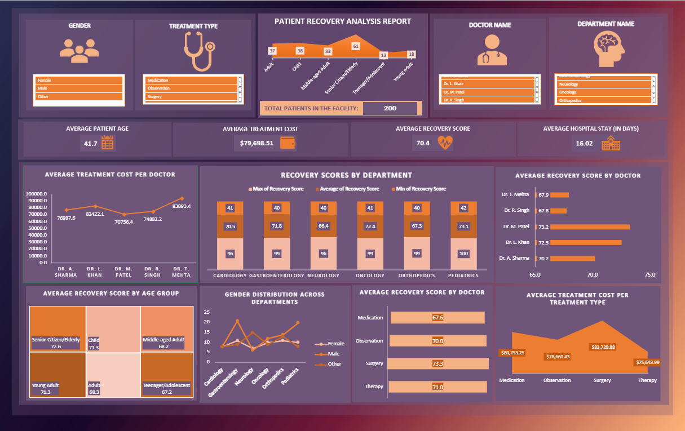

# Patient Recovery Analysis — Excel Dashboard

**A patient-treatment data exploration and visualization project built in Microsoft Excel.**

## Dashboard preview

## Overview
This project presents a dashboard for exploring patient-treatment and recovery-related data in Excel. It is a portfolio example of turning a dataset into a visual report.

## Project files
- [Excel dashboard workbook](./Patient_Analysis_Report.xlsx) — open this file in Excel to explore the report.
- [Dashboard walkthrough video](./Patient_Recovery_Analysis.mp4) — demonstration of the dashboard.
- [Dashboard screenshot](./db_excel1.png) — quick preview.

## Dataset
Source: [Hospital Patient Treatment Dataset on Kaggle](https://www.kaggle.com/datasets/slidescope/hospital-patient-treatment-dataset/).

## How to explore
Download the `.xlsx` file, open it in Microsoft Excel, and use the controls available in the workbook to explore the report. The screenshot and video offer a preview without opening the workbook.

> This is a data-visualization portfolio project, not a clinical decision-support system.

---
**Portfolio:** [More projects by Dharshini](https://github.com/Dharshini03090309)
